# Joshua C. Macdonald — research website

Source for [jcmacdonald.dev](https://jcmacdonald.dev/), my research portfolio,
software descriptions, publications and CV. The site uses Jekyll and the
[al-folio theme](https://github.com/alshedivat/al-folio), with automatic GitHub
Pages deployment from this repository.

The public software stack connects structured model specification
([op_system](https://github.com/ACCIDDA/op_system)), numerical execution
([op_engine](https://github.com/ACCIDDA/op_engine)), campaign orchestration
([FlepiMoP2](https://github.com/ACCIDDA/flepimop2)) and replicated design/evaluation
([trade-study](https://github.com/jcm-sci/trade-study)). Package APIs, releases and
scientific qualification live in their own repositories; this site describes
their roles, current scope and research applications.

| Content                           | Source                             |
| --------------------------------- | ---------------------------------- |
| Homepage and software overview    | `_pages/about.md`                  |
| Project descriptions and metadata | `_projects/`                       |
| Repository-card descriptions      | `_data/repositories.yml`           |
| CV page and rendered PDF source   | `_data/cv.yml`, `assets/rendercv/` |
| Publications                      | `_bibliography/papers.bib`         |

Research figures have [editable TikZ/plotting sources and build instructions](assets/img/research/README.md),
with SVGs for the site and PDFs for reuse. The [figure gallery](https://jcmacdonald.dev/figures/)
links the individual sources and exports.

For editing and preview instructions, see [AGENTS.md](AGENTS.md),
[INSTALL.md](INSTALL.md) and [CUSTOMIZE.md](CUSTOMIZE.md). Pull requests run the
site build and formatting checks; merging publishes the generated site to
`gh-pages`. Edit source content, rather than generated pages.

The deploy workflow first calls the read-only RenderCV workflow, which validates
and renders `_data/cv.yml` with the checked-in design, locale and settings and the
version pinned in `requirements-rendercv.txt`. The site build waits for those PDFs
and verifies their source revision, input hashes and identical content before
packaging. A render or provenance failure blocks publication; branch concurrency
cancels superseded builds. No generated-source commit or second push is needed.

PRs use this same production path and command, including changes to CV source,
design/locale/settings, renderer requirements or helper scripts. Download the
`cv-<source SHA>` artifact from **Deploy site → Validate and preview CV** to review
both the RenderCV PDF and `assets/pdf/cv.pdf`. Artifacts expire after 14 days. PRs
validate and upload previews without committing or publishing. The live
[`assets/rendercv/provenance.json`](https://jcmacdonald.dev/assets/rendercv/provenance.json)
records the deployed CV's revision, input hashes, renderer version and PDF hash.
Tracked PDFs are reference snapshots. Publication overlays fresh verified
artifacts from that same workflow run.

To reproduce the renderer locally in an activated Python 3.12 environment:

```bash
pip install -r requirements-rendercv.txt
python .github/scripts/render_cv.py render --output-dir /tmp/cv-preview
python .github/scripts/render_cv.py verify --output-dir /tmp/cv-preview
# Install poppler-utils for pdftotext, used by the regression checks.
python -m unittest discover -s .github/tests -p 'test_render_cv.py' -v
# With the site's Ruby/Jekyll dependencies available, also test a source-only
# name change reaching both generated HTML and the downloadable PDF:
CV_SITE_INTEGRATION=1 python -m unittest discover -s .github/tests -p 'test_render_cv.py' -v
```

Use a new or empty output directory for each render. Rendering leaves tracked
source snapshots unchanged. The tests include a recognizable synthetic name in
a temporary copy, invalid schema rejection and mismatched revision/input/PDF
rejection; synthetic content is never written to the source checkout.

The **Check source and external links** workflow runs on pull requests and source
pushes. It builds Jekyll to resolve Liquid, then checks HTTP(S) anchors on the
maintained pages listed in [the scope manifest](.github/source-link-pages.txt),
including every project page and its outgoing software/source links. The
inherited filename patterns in `.lycheeignore` were removed because Lychee
interprets them as URL patterns and silently skipped real README links. Missing
manifest outputs and unresolved anchor Liquid fail the check. Retained theme posts/books/examples, image/script/CDN
resources and email addresses are outside this external-anchor check. The
separate **Check for broken links on site** workflow checks generated internal
paths offline; neither check claims to validate external fragments.

External checks use [pinned Lychee settings](.github/lychee.toml), bounded retries
and timeouts. Exhausted transient failures fail CI and should be retried after
investigation. Authentication or robot-blocked exceptions must name a narrow
URL pattern and explain why it cannot be checked; do not accept all 403/429
responses or exclude software hosts. Two exact publisher-blocked DOIs are checked
against Crossref registration instead of their landing pages; individual
ResearchGate, Scholar and LinkedIn profiles, three JHU landing pages and one
CDC landing page require manual review because they block automated clients. The test suite demonstrates failure on a controlled
README 404 followed by success on the corrected target.

To reproduce after installing the site's Ruby/Python dependencies and Lychee
0.24.2:

```bash
JEKYLL_ENV=production bundle exec jekyll build
python .github/scripts/check_source_links.py _site /tmp/source-links.txt
lychee --config .github/lychee.toml --no-progress /tmp/source-links.txt
python -m unittest discover -s .github/tests -p 'test_source_links.py' -v
```

The retained al-folio reference below documents the theme and its upstream
community. Theme attribution and licensing are preserved in [LICENSE](LICENSE).

---

# al-folio

<div align="center">

[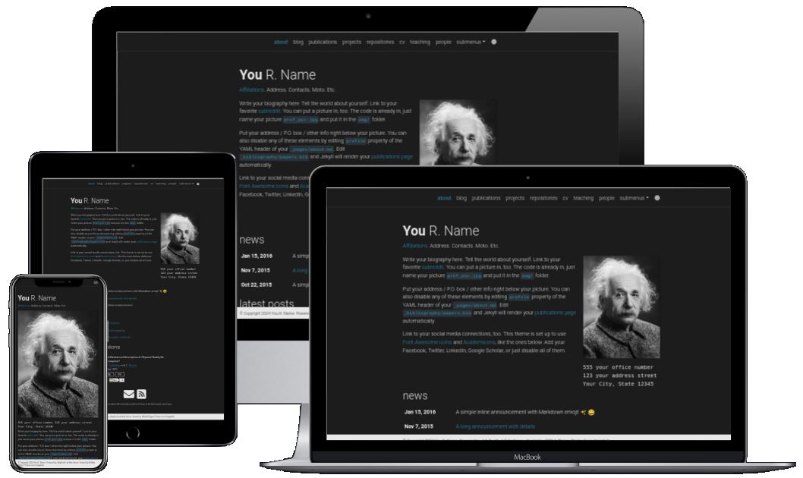](https://alshedivat.github.io/al-folio/)

**A simple, clean, and responsive [Jekyll](https://jekyllrb.com/) theme for academics.**

---

[](https://github.com/alshedivat/al-folio/actions/workflows/deploy.yml)
[](#maintainers)
[](https://github.com/alshedivat/al-folio/graphs/contributors/)

[](https://hub.docker.com/r/amirpourmand/al-folio)
[](https://hub.docker.com/r/amirpourmand/al-folio)
[](https://hub.docker.com/r/amirpourmand/al-folio)

[](https://github.com/alshedivat/al-folio/releases/latest)
[](https://github.com/alshedivat/al-folio/blob/main/LICENSE)
[](https://github.com/alshedivat/al-folio/stargazers)
[](https://github.com/alshedivat/al-folio/fork)

[](https://codewiki.google/github.com/alshedivat/al-folio)
[](https://deepwiki.com/alshedivat/al-folio)

</div>

## User community

The vibrant community of **al-folio** users is growing!
Academics around the world use this theme for their homepages, blogs, lab pages, as well as webpages for courses, workshops, conferences, meetups, and more.
Check out the community webpages below.
Feel free to add your own page(s) by sending a PR.

<table>
<tr>
<td>Academics</td>
<td>
<a href="https://martinbulla.github.io" target="_blank">★</a>
<a href="https://maruan.alshedivat.com" target="_blank">★</a>
<a href="https://www.cs.columbia.edu/~chen1ru/" target="_blank">★</a>
<a href="https://maithraraghu.com" target="_blank">★</a>
<a href="https://platanios.org" target="_blank">★</a>
<a href="https://otiliastr.github.io" target="_blank">★</a>
<a href="https://www.maths.dur.ac.uk/~sxwc62/" target="_blank">★</a>
<a href="https://jessachandler.com/" target="_blank">★</a>
<a href="https://mayankm96.github.io/" target="_blank">★</a>
<a href="https://markdean.info/" target="_blank">★</a>
<a href="https://kakodkar.github.io/" target="_blank">★</a>
<a href="https://sahirbhatnagar.com/" target="_blank">★</a>
<a href="https://spd.gr/" target="_blank">★</a>
<a href="https://jay-sarkar.github.io/" target="_blank">★</a>
<a href="https://aborowska.github.io/" target="_blank">★</a>
<a href="https://aditisgh.github.io/" target="_blank">★</a>
<a href="https://alexhaydock.co.uk/" target="_blank">★</a>
<a href="https://alixkeener.net/" target="_blank">★</a>
<a href="https://andreea7b.github.io/" target="_blank">★</a>
<a href="https://rishabhjoshi.github.io/" target="_blank">★</a>
<a href="https://sheelabhadra.github.io/" target="_blank">★</a>
<a href="https://giograno.me/" target="_blank">★</a>
<a href="https://immsrini.github.io/" target="_blank">★</a>
<a href="https://apooladian.github.io/" target="_blank">★</a>
<a href="https://chinmoy-dutta.github.io/" target="_blank">★</a>
<a href="https://liamcli.com/" target="_blank">★</a>
<a href="https://yoonholee.com/" target="_blank">★</a>
<a href="https://zrqiao.github.io/" target="_blank">★</a>
<a href="https://abstractgeek.github.io/" target="_blank">★</a>
<a href="https://www.compphys.de/" target="_blank">★</a>
<a href="https://julianstreyczek.github.io" target="_blank">★</a>
<a href="https://sdaza.com" target="_blank">★</a>
<a href="https://niweera.gq" target="_blank">★</a>
<a href="https://www.alihkw.com" target="_blank">★</a>
<a href="https://amirpourmand.ir" target="_blank">★</a>
<a href="https://scottleechua.github.io" target="_blank">★</a>
<a href="https://sk1y101.github.io" target="_blank">★</a>
<a href="https://yyang768osu.github.io" target="_blank">★</a>
<a href="https://veedata.github.io" target="_blank">★</a>
<a href="https://K-Wu.github.io" target="_blank">★</a>
<a href="https://amalawilson.com" target="_blank">★</a>
<a href="https://tirtharajdash.github.io" target="_blank">★</a>
<a href="https://carolinacarreira.github.io" target="_blank">★</a>
<a href="https://manandey.github.io" target="_blank">★</a>
<a href="https://johanneshoerner.github.io" target="_blank">★</a>
<a href="https://ioannismavromatis.com" target="_blank">★</a>
<a href="https://taidnguyen.github.io" target="_blank">★</a>
<a href="https://lbugnon.github.io" target="_blank">★</a>
<a href="https://joahannes.github.io" target="_blank">★</a>
<a href="https://dominikstrb.github.io" target="_blank">★</a>
<a href="https://tylerbarna.com" target="_blank">★</a>
<a href="https://daviddmc.github.io/" target="_blank">★</a>
<a href="https://andreaskuster.ch/" target="_blank">★</a>
<a href="https://ellisbrown.github.io/" target="_blank">★</a>
<a href="https://djherron.github.io/" target="_blank">★</a>
<a href="https://rodosingh.github.io/" target="_blank">★</a>
<a href="https://vdivakar.github.io/" target="_blank">★</a>
<a href="https://george-gca.github.io/" target="_blank">★</a>
<a href="https://bashirkazimi.github.io/" target="_blank">★</a>
<a href="https://dohaison.github.io/" target="_blank">★</a>
<a href="https://raphaaal.github.io/" target="_blank">★</a>
<a href="https://varuniyer.info/" target="_blank">★</a>
<a href="https://yukimasano.github.io/" target="_blank">★</a>
<a href="https://hashe037.github.io/" target="_blank">★</a>
<a href="https://wang-boyu.github.io/" target="_blank">★</a>
<a href="https://qingqingchen.info" target="_blank">★</a>
<a href="https://bajinsheng.github.io/" target="_blank">★</a>
<a href="https://www.silviofanzon.com/" target="_blank">★</a>
<a href="https://kaikaiyao.github.io/" target="_blank">★</a>
<a href="https://alchemz.github.io/" target="_blank">★</a>
<a href="https://samadamday.com/" target="_blank">★</a>
<a href="https://fanpu.io/" target="_blank">★</a>
<a href="https://abigalekim.github.io/" target="_blank">★</a>
<a href="https://lucasresck.github.io/" target="_blank">★</a>
<a href="https://users.wpi.edu/~lfichera/" target="_blank">★</a>
<a href="https://anmspro.github.io/" target="_blank">★</a>
<a href="https://berlyne.net/" target="_blank">★</a>
<a href="https://filippomazzoli.github.io/" target="_blank">★</a>
<a href="https://www.escontrela.me/" target="_blank">★</a>
<a href="https://raffaem.github.io/" target="_blank">★</a>
<a href="https://cbueth.de/" target="_blank">★</a>
<a href="https://kyleaoman.github.io/" target="_blank">★</a>
<a href="https://decwest.github.io/" target="_blank">★</a>
<a href="https://www.jedburkat.com" target="_blank">★</a>
<a href="https://hrzhang.me" target="_blank">★</a>
<a href="https://kudhru.github.io/" target="_blank">★</a>
<a href="https://mbarbetti.github.io/" target="_blank">★</a>
<a href="https://www.zhivotenko.com/" target="_blank">★</a>
<a href="https://giordanodaloisio.github.io/" target="_blank">★</a>
<a href="https://aadityaura.github.io/" target="_blank">★</a>
<a href="https://abhinav-mehta.github.io/" target="_blank">★</a>
<a href="https://shubhashisroydipta.com/" target="_blank">★</a>
<a href="https://astanziola.github.io" target="_blank">★</a>
<a href="https://tinkerer.in" target="_blank">★</a>
<a href="https://afraniomelo.github.io/en/" target="_blank">★</a>
<a href="https://jonaruthardt.github.io" target="_blank">★</a>
<a href="https://www.zla.app/" target="_blank">★</a>
<a href="https://stavros.github.io" target="_blank">★</a>
<a href="https://ericslyman.com" target="_blank">★</a>
<a href="https://ztjona.github.io/" target="_blank">★</a>
<a href="https://chrischoi314.github.io" target="_blank">★</a>
<a href="https://riccobelli.faculty.polimi.it" target="_blank">★</a>
<a href="https://kishanved.tech/" target="_blank">★</a>
<a href="https://abhilesh.github.io/" target="_blank">★</a>
<a href="https://jackjburnett.github.io/" target="_blank">★</a>
<a href="https://physics-morris.github.io/" target="_blank">★</a>
<a href="https://sraf.ir" target="_blank">★</a>
<a href="https://acad.garywei.dev/" target="_blank">★</a>
<a href="https://tonideleo.github.io/" target="_blank">★</a>
<a href="https://alonkellner.com/" target="_blank">★</a>
<a href="https://berylbir.github.io/" target="_blank">★</a>
<a href="https://global-anomaly.github.io/" target="_blank">★</a>
<a href="https://mingsun-kaust.github.io/" target="_blank">★</a>
<a href="https://hdocmsu.github.io/" target="_blank">★</a>
<a href="https://trandangtrungduc.github.io/" target="_blank">★</a>
<a href="https://kinghowler.github.io/" target="_blank">★</a>
<a href="https://anurye.github.io/" target="_blank">★</a>
<a href="https://charlie-xiao.github.io/" target="_blank">★</a>
<a href="https://giuseppeperelli.github.io/" target="_blank">★</a>
<a href="https://shlee-lab.github.io/" target="_blank">★</a>
<a href="https://devos50.github.io/" target="_blank">★</a>
<a href="https://vmooers.github.io/" target="_blank">★</a>
<a href="https://jpfonseca.github.io/" target="_blank">★</a>
<a href="https://dmitryryumin.github.io/" target="_blank">★</a>
<a href="https://alexiglad.github.io/" target="_blank">★</a>
<a href="https://nishanthjkumar.com/" target="_blank">★</a>
<a href="https://joszuijderwijk.nl/" target="_blank">★</a>
<a href="https://d-jiao.github.io/" target="_blank">★</a>
<a href="https://cbuelt.github.io/" target="_blank">★</a>
<a href="https://mehrdad-noori.github.io/" target="_blank">★</a>
<a href="https://arthurclerjon.github.io/" target="_blank">★</a>
<a href="https://eilamshapira.com/" target="_blank">★</a>
<a href="https://freifrauvonbleifrei.github.io/" target="_blank">★</a>
<a href="https://thomasbourke1.github.io/" target="_blank">★</a>
<a href="https://siddharthsule.com/" target="_blank">★</a>
<a href="https://waynexucn.github.io/" target="_blank">★</a>
<a href="https://zlatanajanovic.com/" target="_blank">★</a>
<a href="https://mchadolias.github.io/" target="_blank">★</a>
<a href="https://syanyong.github.io/" target="_blank">★</a>
<a href="https://jucheval.github.io/" target="_blank">★</a>
<a href="https://j1yoo.github.io/" target="_blank">★</a>
<a href="https://zhoji.github.io/" target="_blank">★</a>
<a href="https://smsnobin77.github.io/" target="_blank">★</a>
<a href="https://dongkyu-lee.info/" target="_blank">★</a>
<a href="https://laurajul.github.io/" target="_blank">★</a>
<a href="https://vud.org" target="_blank">★</a>
<a href="https://www.byeongsc.com/" target="_blank">★</a>
</td>
</tr>
<tr>
<td>Labs</td>
<td>
<a href="https://www.haylab.caltech.edu/" target="_blank">★</a>
<a href="https://sjkimlab.github.io/" target="_blank">★</a>
<a href="https://systemconsultantgroup.github.io/scg-folio/" target="_blank">★</a>
<a href="https://decisionlab.ucsf.edu/" target="_blank">★</a>
<a href="https://programming-group.com/" target="_blank">★</a>
<a href="https://sailing-lab.github.io/" target="_blank">★</a>
<a href="https://inbt.jhu.edu/epidiagnostics/" target="_blank">★</a>
<a href="https://www.nuesl.org/" target="_blank">★</a>
<a href="https://big-culture.github.io/" target="_blank">★</a>
<a href="https://martinbulla.github.io/bullab/" target="_blank">★</a>
<a href="https://gpforesteyes.github.io/" target="_blank">★</a>
<a href="https://kenji-fukushima-lab.github.io/" target="_blank">★</a>
</td>
</tr>
<tr>
<td>Courses</td>
<td>
CMU PGM (<a href="https://sailinglab.github.io/pgm-spring-2019/" target="_blank">S-19</a>) <br>
CMU DeepRL (<a href="https://cmudeeprl.github.io/403_website/" target="_blank">S-21</a>, <a href="https://cmudeeprl.github.io/703website_f21/" target="_blank">F-21</a>, <a href="https://cmudeeprl.github.io/403website_s22/" target="_blank">S-22</a>, <a href="https://cmudeeprl.github.io/703website_f22/" target="_blank">F-22</a>, <a href="https://cmudeeprl.github.io/403website_s23/" target="_blank">S-23</a>, <a href="https://cmudeeprl.github.io/703website_f23/" target="_blank">F-23</a>) <br>
CMU MMML (<a href="https://cmu-multicomp-lab.github.io/mmml-course/fall2020/" target="_blank">F-20</a>, <a href="https://cmu-multicomp-lab.github.io/mmml-course/fall2022/" target="_blank">F-22</a>) <br>
CMU AMMML (<a href="https://cmu-multicomp-lab.github.io/adv-mmml-course/spring2022/" target="_blank">S-22</a>, <a href="https://cmu-multicomp-lab.github.io/adv-mmml-course/spring2023/" target="_blank">S-23</a>) <br>
CMU ASI (<a href="https://cmu-multicomp-lab.github.io/asi-course/spring2023/" target="_blank">S-23</a>) <br>
CMU Distributed Systems (<a href="https://andrew.cmu.edu/course/15-440/" target="_blank">S-24</a>)
</td>
</tr>
<tr>
<td>Conferences & workshops</td>
<td>
ICLR Blog Post Track (<a href="https://iclr-blogposts.github.io/2023/" target="_blank">2023</a>, <a href="https://iclr-blogposts.github.io/2024/about" target="_blank">2024</a>) <br>
ML Retrospectives (NeurIPS: <a href="https://ml-retrospectives.github.io/neurips2019/" target="_blank">2019</a>, <a href="https://ml-retrospectives.github.io/neurips2020/" target="_blank">2020</a>; ICML: <a href="https://ml-retrospectives.github.io/icml2020/" target="_blank">2020</a>) <br>
HAMLETS (NeurIPS: <a href="https://hamlets-workshop.github.io/" target="_blank">2020</a>) <br>
ICBINB (NeurIPS: <a href="https://i-cant-believe-its-not-better.github.io/" target="_blank">2020</a>, <a href="https://i-cant-believe-its-not-better.github.io/neurips2021/" target="_blank">2021</a>) <br>
Neural Compression (ICLR: <a href="https://neuralcompression.github.io/" target="_blank">2021</a>) <br>
Score Based Methods (NeurIPS: <a href="https://score-based-methods-workshop.github.io/" target="_blank">2022</a>)<br>
Images2Symbols (CogSci: <a href="https://images2symbols.github.io/" target="_blank"> 2022</a>) <br>
Medical Robotics Junior Faculty Forum (ISMR: <a href="https://junior-forum-ismr.github.io/" target="_blank"> 2023</a>)<br>
Beyond Vision: Physics meets AI (ICIAP: <a href="https://physicsmeetsai.github.io/beyond-vision/" target="_blank">2023</a>) <br>
Workshop on Diffusion Models (NeurIPS: <a href="https://diffusionworkshop.github.io/" target="_blank">2023</a>) <br>
Workshop on Structured Probabilistic Inference & Generative Modeling (ICML: <a href="https://spigmworkshop.github.io/" target="_blank">2023</a>, <a href="https://spigmworkshop2024.github.io/" target="_blank">2024</a>) <br>
Workshop on Foundation and Generative Models in Biometrics (<a href="https://foundgen-bio.github.io/iccv2025/" target="_blank">ICCV 2025</a>, <a href="https://foundgen-bio.github.io/cvpr2026/" target="_blank">CVPR 2026</a>)
</td>
</tr>
</table>

## Lighthouse PageSpeed Insights

### Desktop

[](https://htmlpreview.github.io/?https://github.com/alshedivat/al-folio/blob/main/lighthouse_results/desktop/alshedivat_github_io_al_folio_.html)

Run the test yourself: [Google Lighthouse PageSpeed Insights](https://pagespeed.web.dev/report?url=https%3A%2F%2Falshedivat.github.io%2Fal-folio%2F&form_factor=desktop)

### Mobile

[](https://htmlpreview.github.io/?https://github.com/alshedivat/al-folio/blob/main/lighthouse_results/mobile/alshedivat_github_io_al_folio_.html)

Run the test yourself: [Google Lighthouse PageSpeed Insights](https://pagespeed.web.dev/report?url=https%3A%2F%2Falshedivat.github.io%2Fal-folio%2F&form_factor=mobile)

## Table Of Contents

<!--ts-->

- [Joshua C. Macdonald — research website](#joshua-c-macdonald--research-website)
- [al-folio](#al-folio)
  - [User community](#user-community)
  - [Lighthouse PageSpeed Insights](#lighthouse-pagespeed-insights)
    - [Desktop](#desktop)
    - [Mobile](#mobile)
  - [Table Of Contents](#table-of-contents)
  - [Getting started](#getting-started)
  - [Installing and Deploying](#installing-and-deploying)
  - [Customizing](#customizing)
  - [GitHub Copilot Agents](#github-copilot-agents)
    - [Customization Agent](#customization-agent)
    - [Documentation Agent](#documentation-agent)
  - [Documentation](#documentation)
  - [Features](#features)
    - [Light/Dark Mode](#lightdark-mode)
    - [CV](#cv)
    - [People](#people)
    - [Publications](#publications)
    - [Collections](#collections)
    - [Layouts](#layouts)
      - [The iconic style of Distill](#the-iconic-style-of-distill)
      - [Full support for math &amp; code](#full-support-for-math--code)
      - [Photos, Audio, Video and more](#photos-audio-video-and-more)
    - [Other features](#other-features)
      - [GitHub's repositories and user stats](#githubs-repositories-and-user-stats)
      - [Theming](#theming)
      - [Social media previews](#social-media-previews)
      - [Atom (RSS-like) Feed](#atom-rss-like-feed)
      - [Related posts](#related-posts)
      - [Code quality checks](#code-quality-checks)
      - [GDPR Cookie Consent Dialog](#gdpr-cookie-consent-dialog)
  - [FAQ](#faq)
  - [Contributing](#contributing)
    - [Maintainers](#maintainers)
    - [All Contributors](#all-contributors)
  - [Star History](#star-history)
  - [License](#license)
    - [Research pages and publication records](#research-pages-and-publication-records)

<!--te-->

## Getting started

**⚠️ Important: Use "Use this template" (not fork)**

When creating your own website with al-folio, you have two options:

- ✅ **Recommended:** Click "[Use this template](https://github.com/new?template_name=al-folio&template_owner=alshedivat)" – This creates a clean copy that is independent from the main al-folio repository. Changes you make to your site won't be accidentally submitted to al-folio as pull requests.
- ❌ **Not recommended:** Forking the repository – This keeps a link to the main al-folio repo, making it easy to accidentally submit your personal site changes as contributions to our project.

**If you already forked:** Don't worry! You can still work with your fork normally. Just make sure to:

1. Make changes on a dedicated branch (e.g., `my-site-updates`)
2. When pushing changes, always verify you're pushing to **your own repository**, not the main al-folio repository
3. Never create pull requests to `alshedivat/al-folio` unless you're intentionally contributing improvements that benefit all users

For quick setup, see [QUICKSTART.md](QUICKSTART.md).

Want to learn more about Jekyll? Check out [this tutorial](https://www.taniarascia.com/make-a-static-website-with-jekyll/). Why Jekyll? Read [Andrej Karpathy's blog post](https://karpathy.github.io/2014/07/01/switching-to-jekyll/)! Why write a blog? Read [Rachel Thomas blog post](https://medium.com/@racheltho/why-you-yes-you-should-blog-7d2544ac1045).

## Installing and Deploying

For installation and deployment details please refer to [INSTALL.md](INSTALL.md).

## Customizing

For customization details please refer to [CUSTOMIZE.md](CUSTOMIZE.md).

## GitHub Copilot Agents

This repository includes two specialized GitHub Copilot agents to enhance your development experience:

### Customization Agent

The **Customization Agent** helps you personalize your al-folio website by:

- Guiding you through configuration changes step-by-step
- Modifying files directly in your repository
- Explaining technical concepts in plain language (great for users without coding experience)
- Assisting with common tasks like updating your CV, adding publications, creating blog posts, and customizing themes

See [CUSTOMIZE.md § GitHub Copilot Customization Agent](CUSTOMIZE.md#github-copilot-customization-agent) for detailed usage instructions.

### Documentation Agent

The **Documentation Agent** maintains clear and up-to-date project documentation by:

- Updating documentation files when features change
- Writing in a style accessible to academics and researchers
- Keeping documentation synchronized with the codebase
- Following documentation best practices

See [CONTRIBUTING.md § GitHub Copilot Agents](CONTRIBUTING.md#github-copilot-agents) for more information.

> **Requirements:** Both agents require a [GitHub Copilot](https://github.com/features/copilot) subscription. For more information about GitHub Copilot and how to use agents, see the [GitHub Copilot documentation](https://docs.github.com/en/copilot).

## Documentation

Theme setup and maintenance guides:

- **[Quick Start](QUICKSTART.md)** – Local setup
- **[Installation & Deployment](INSTALL.md)** – Set up your site on GitHub Pages or other platforms
- **[Customization Guide](CUSTOMIZE.md)** – Personalize your website (CVs, publications, themes, etc.)
- **[Troubleshooting](TROUBLESHOOTING.md)** – Fix common issues (deployment, build, styling, content)
- **[FAQ](FAQ.md)** – Frequently asked questions and solutions
- **[Analytics](ANALYTICS.md)** – Add website analytics and visitor tracking
- **[SEO Guide](SEO.md)** – Optimize for search engines and improve discoverability

## Features

### Light/Dark Mode

This template has a built-in light/dark mode. It detects the user preferred color scheme and automatically switches to it. You can also manually switch between light and dark mode by clicking on the sun/moon icon in the top right corner of the page.

<p align="center">
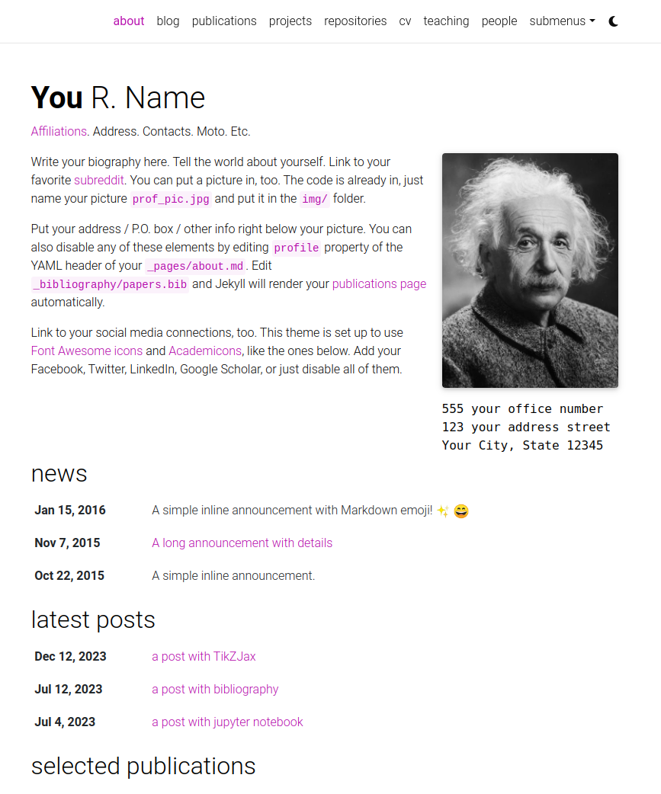
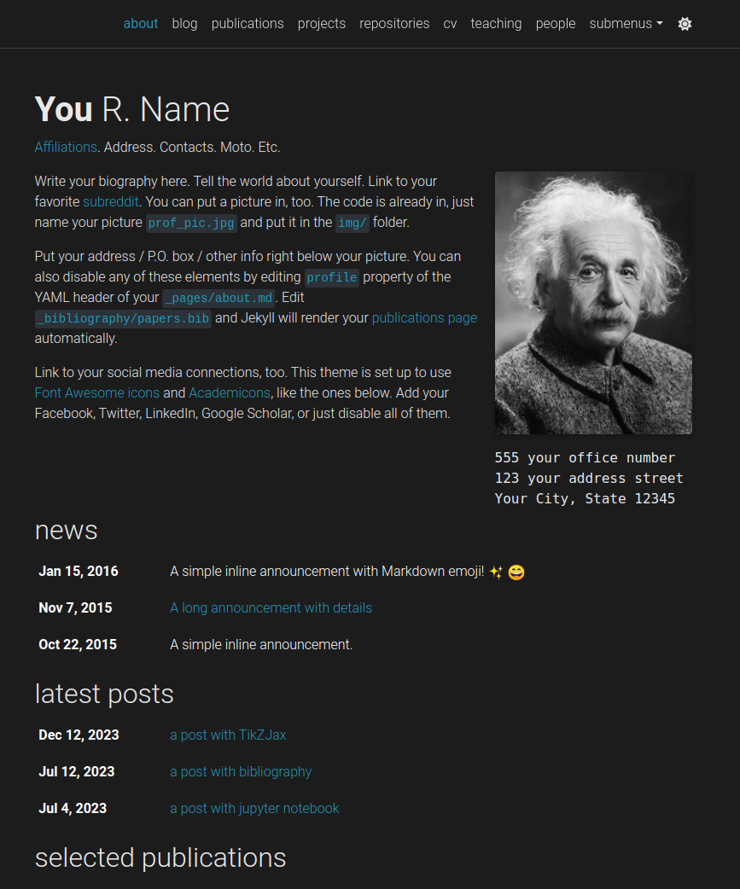
</p>

---

### CV

Your CV can be generated in one of two modern formats: **RenderCV** (recommended, with automatic PDF generation) or **JSONResume** (standardized JSON format). You can use both simultaneously and switch between them, or maintain just the one you prefer.

[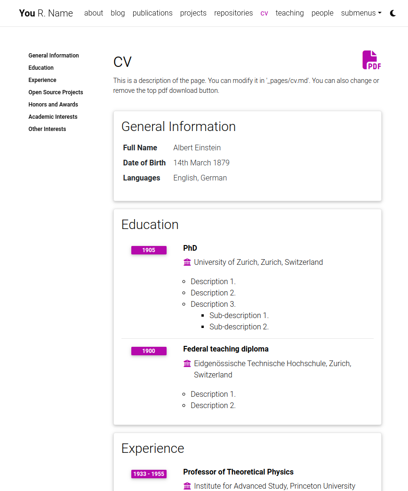](https://alshedivat.github.io/al-folio/cv/)

For setup and customization details, see [Modifying the CV information](CUSTOMIZE.md#modifying-the-cv-information) in [CUSTOMIZE.md](CUSTOMIZE.md).

---

### People

You can create a people page if you want to feature more than one person. Each person can have its own short bio, profile picture, and you can also set if every person will appear at the same or opposite sides.

[](https://alshedivat.github.io/al-folio/people/)

---

### Publications

Your publications page is generated automatically from your BibTeX bibliography. You can customize publication display, add extra information like PDFs, and control sorting behavior.

[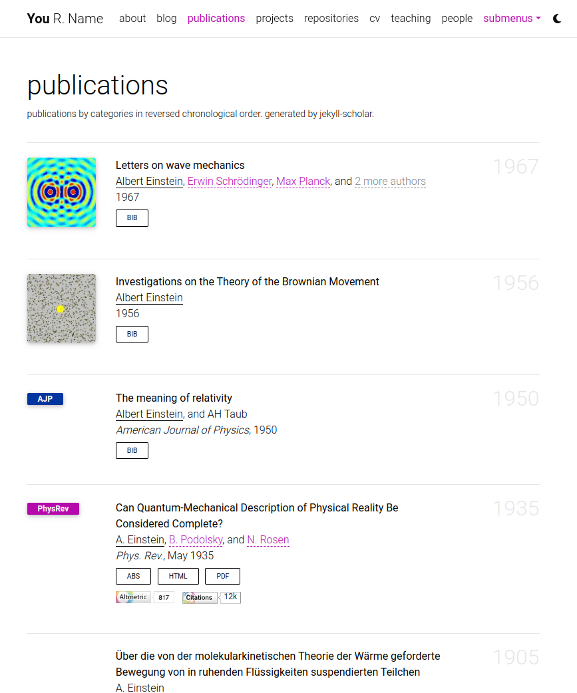](https://alshedivat.github.io/al-folio/publications/)

For setup, BibTeX field documentation, and customization options, see [Adding a new publication](CUSTOMIZE.md#adding-a-new-publication) and [Managing publication display](CUSTOMIZE.md#managing-publication-display) in [CUSTOMIZE.md](CUSTOMIZE.md).

---

### Collections

This Jekyll theme implements `collections` to organize content into categories. The theme comes with default collections for `news`, `projects`, `books`, and `teachings`. You can easily create your own collections for apps, stories, courses, or any other creative work.

[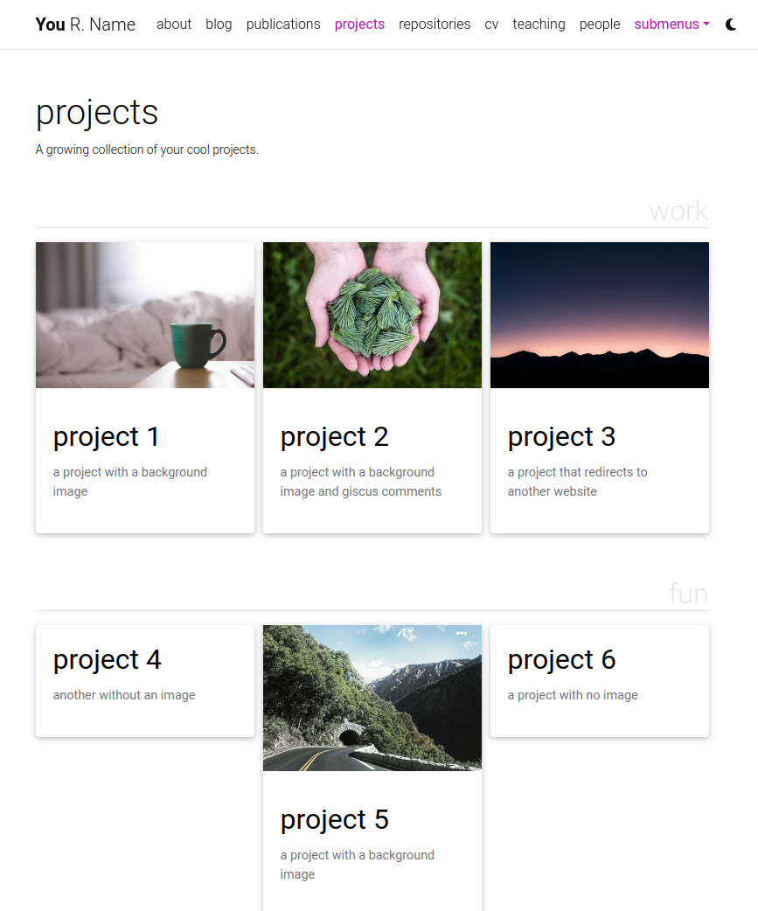](https://alshedivat.github.io/al-folio/projects/)

For detailed instructions on creating and customizing collections, see [Adding Collections](CUSTOMIZE.md#adding-collections) in [CUSTOMIZE.md](CUSTOMIZE.md).

---

### Layouts

**al-folio** comes with stylish layouts for pages and blog posts.

#### The iconic style of Distill

The theme allows you to create blog posts in the [distill.pub](https://distill.pub/) style:

[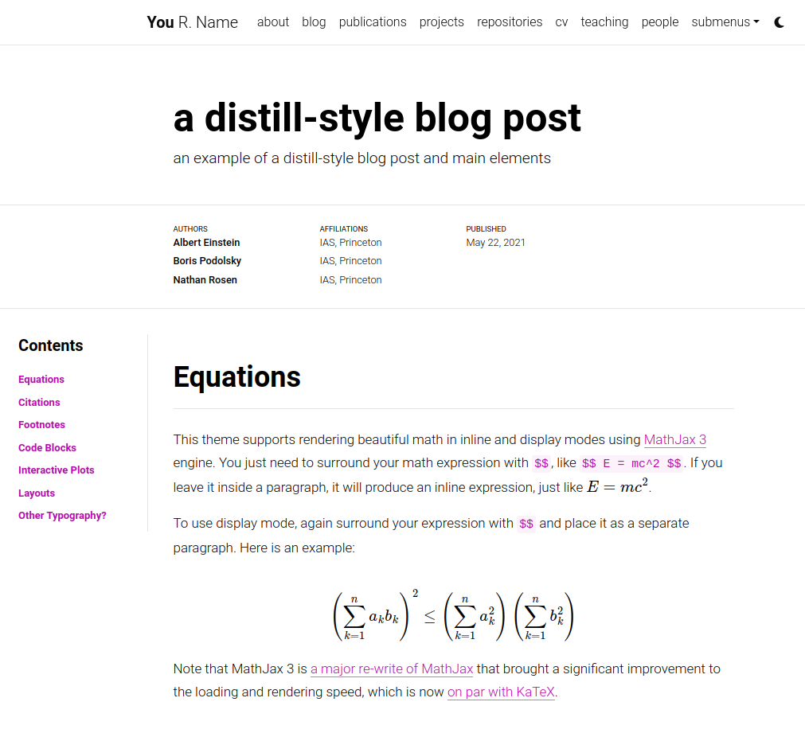](https://alshedivat.github.io/al-folio/blog/2021/distill/)

For more details on how to create distill-styled posts using `<d-*>` tags, please refer to [the example](https://alshedivat.github.io/al-folio/blog/2021/distill/).

#### Full support for math & code

**al-folio** supports fast math typesetting through [MathJax](https://www.mathjax.org/) and code syntax highlighting using [GitHub style](https://github.com/jwarby/jekyll-pygments-themes). Also supports [chartjs charts](https://www.chartjs.org/), [mermaid diagrams](https://mermaid-js.github.io/mermaid/#/), and [TikZ figures](https://tikzjax.com/).

<p align="center">
<a href="https://alshedivat.github.io/al-folio/blog/2015/math/" target="_blank">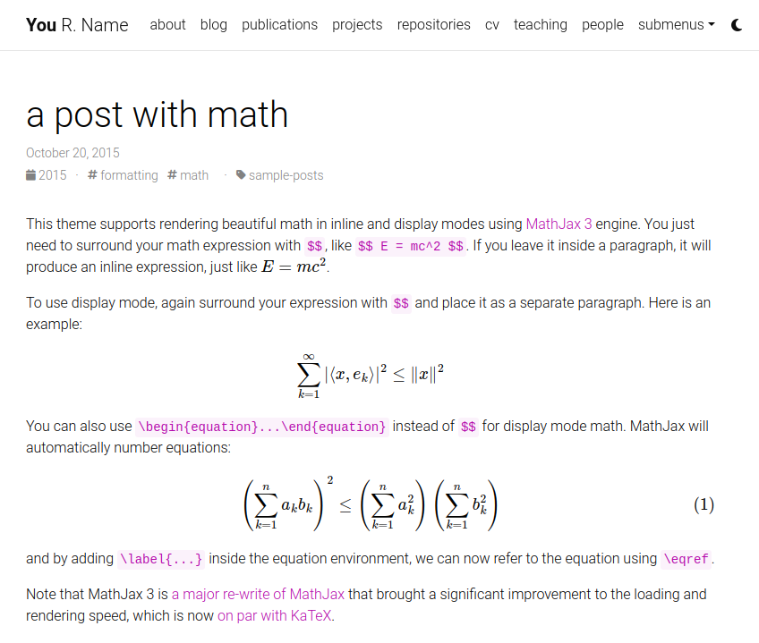</a>
<a href="https://alshedivat.github.io/al-folio/blog/2015/code/" target="_blank">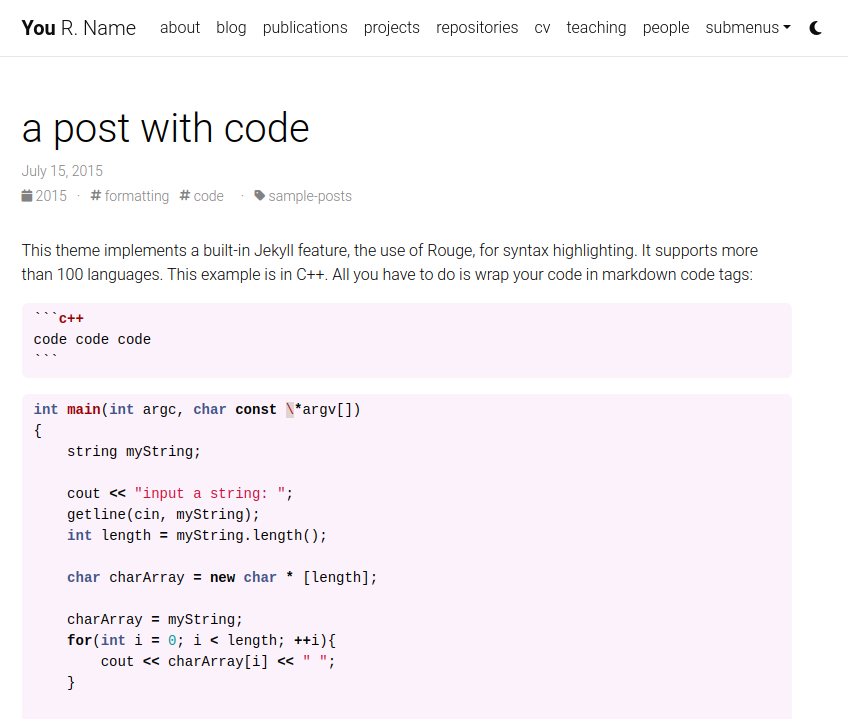</a>
</p>

#### Photos, Audio, Video and more

Photo formatting is made simple using [Bootstrap's grid system](https://getbootstrap.com/docs/4.4/layout/grid/). Easily create beautiful grids within your blog posts and project pages, also with support for [video](https://alshedivat.github.io/al-folio/blog/2023/videos/) and [audio](https://alshedivat.github.io/al-folio/blog/2023/audios/) embeds:

<p align="center">
  <a href="https://alshedivat.github.io/al-folio/projects/1_project/">
    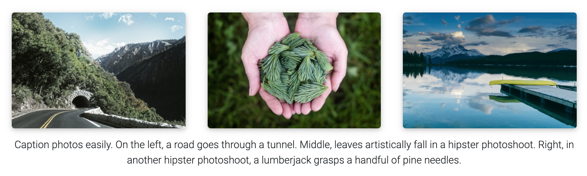
  </a>
</p>

---

### Other features

#### GitHub's repositories and user stats

**al-folio** displays GitHub repositories and user stats on the `/repositories/` page using [github-readme-stats](https://github.com/anuraghazra/github-readme-stats) and [github-profile-trophy](https://github.com/ryo-ma/github-profile-trophy).

[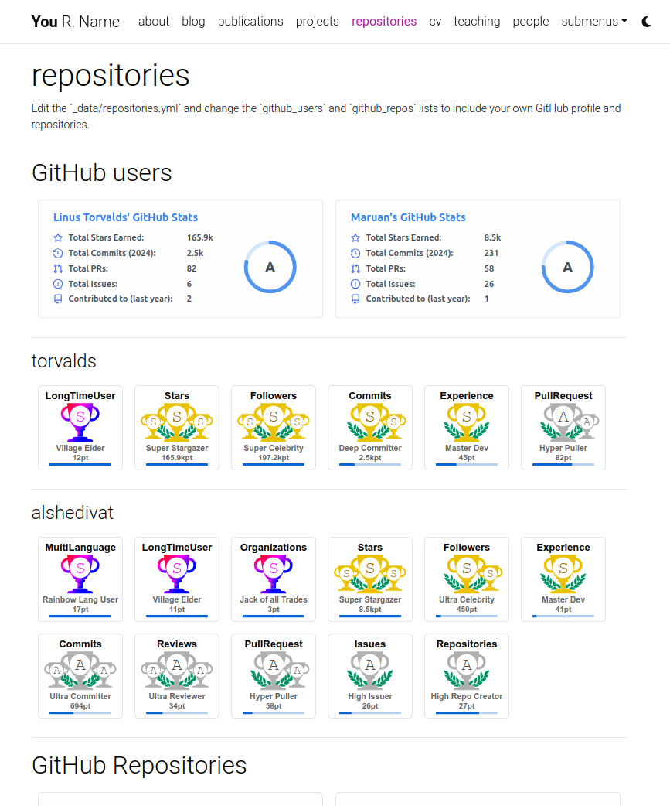](https://alshedivat.github.io/al-folio/repositories/)

To configure which repositories and GitHub profiles to display, see [Modifying the user and repository information](CUSTOMIZE.md#modifying-the-user-and-repository-information) in [CUSTOMIZE.md](CUSTOMIZE.md).

---

#### Theming

**al-folio** offers a variety of beautiful theme colors to choose from. The default is purple, but you can customize colors, fonts, spacing, and more to match your style.

For detailed customization instructions, see [Changing theme color](CUSTOMIZE.md#changing-theme-color) and [Customizing fonts, spacing, and more](CUSTOMIZE.md#customizing-fonts-spacing-and-more) in [CUSTOMIZE.md](CUSTOMIZE.md).

---

#### Social media previews

**al-folio** supports Open Graph preview images on social media. When enabled, your site's pages display rich preview objects with images, titles, and descriptions when shared.

For setup and customization, see [Social media previews](CUSTOMIZE.md#social-media-previews) in [CUSTOMIZE.md](CUSTOMIZE.md).

---

#### Atom (RSS-like) Feed

It generates an Atom (RSS-like) feed of your posts, useful for Atom and RSS readers. The feed is reachable simply by typing after your homepage `/feed.xml`. E.g. assuming your website mountpoint is the main folder, you can type `yourusername.github.io/feed.xml`

---

#### Related posts

By default, blog posts display related posts at the bottom. These are selected by finding the most recent posts that share tags with the current post. You can customize this behavior on a per-post or site-wide basis.

For configuration details, see [Related posts](CUSTOMIZE.md#related-posts) in [CUSTOMIZE.md](CUSTOMIZE.md).

---

#### Code quality checks

Currently, we run some checks to ensure that the code quality and generated site are good. The checks are done using GitHub Actions and the following tools:

- [Prettier](https://prettier.io/) - check if the formatting of the code follows the style guide
- [lychee](https://lychee.cli.rs/) - check for broken links
- [Axe](https://github.com/dequelabs/axe-core) (need to run manually) - do some accessibility testing

We decided to keep `Axe` runs manual because fixing the issues are not straightforward and might be hard for people without web development knowledge.

---

#### GDPR Cookie Consent Dialog

**al-folio** includes a cookie consent dialog powered by [Vanilla Cookie Consent](https://cookieconsent.orestbida.com/). It can be configured with the supported analytics providers.

When enabled, analytics scripts are blocked until the user explicitly consents, and user preferences are saved across visits. This is essential for websites serving visitors in the European Union and other regions with strict privacy regulations.

For complete setup and customization details, see [GDPR Cookie Consent Dialog](#gdpr-cookie-consent-dialog) in [CUSTOMIZE.md](CUSTOMIZE.md).

## FAQ

For frequently asked questions, please refer to [FAQ.md](FAQ.md).

## Contributing

Contributions to al-folio are very welcome! Before you get started, please take a look at [the guidelines](CONTRIBUTING.md).

If you would like to improve documentation or fix a minor inconsistency or bug, please feel free to send a PR directly to `main`. For more complex issues/bugs or feature requests, please open an issue using the appropriate template.

### Maintainers

Our most active contributors are welcome to join the maintainers team. If you are interested, please reach out!

<!-- ALL-CONTRIBUTORS-LIST:START - Do not remove or modify this section -->
<!-- prettier-ignore-start -->
<!-- markdownlint-disable -->
<table>
  <tbody>
    <tr>
      <td align="center" valign="top" width="14.28%"><a href="https://maruan.alshedivat.com"><br /><sub><b>Maruan</b></sub></a></td>
      <td align="center" valign="top" width="14.28%"><a href="https://rohandebsarkar.github.io"><br /><sub><b>Rohan Deb Sarkar</b></sub></a></td>
      <td align="center" valign="top" width="14.28%"><a href="https://amirpourmand.ir"><br /><sub><b>Amir Pourmand</b></sub></a></td>
      <td align="center" valign="top" width="14.28%"><a href="https://george-gca.github.io/"><br /><sub><b>George</b></sub></a></td>
    </tr>
  </tbody>
</table>

<!-- markdownlint-restore -->
<!-- prettier-ignore-end -->

<!-- ALL-CONTRIBUTORS-LIST:END -->

### All Contributors

<a href="https://contrib.rocks">
  
</a>

## Star History

<a href="https://star-history.com/#alshedivat/al-folio&Date">
  <picture>
    <source media="(prefers-color-scheme: dark)" srcset="https://api.star-history.com/svg?repos=alshedivat/al-folio&type=Date&theme=dark" />
    <source media="(prefers-color-scheme: light)" srcset="https://api.star-history.com/svg?repos=alshedivat/al-folio&type=Date" />
    
  </picture>
</a>

## License

The theme is available as open source under the terms of the [MIT License](https://github.com/alshedivat/al-folio/blob/main/LICENSE).

Originally, **al-folio** was based on the [\*folio theme](https://github.com/bogoli/-folio) (published by [Lia Bogoev](https://liabogoev.com) and under the MIT license). Since then, it got a full re-write of the styles and many additional cool features.

### Research pages and publication records

The home page introduces current research before the computed examples and
selected papers. Projects are grouped by release/research status. Edit
`_data/software.yml` for the shared software guide and card availability labels;
use each project's `importance` for order within its group. The figures page
reads `_data/research_figures.yml`, with compact previews generated from the
retained synthetic data by `assets/img/research/previews/card_previews.py`.

The primary menu uses six destinations; `nav_title` can shorten a page title
without changing its URL. Secondary destinations live in the labelled footer.
The source-attributed academic-site comparison and remaining recommendations
are recorded in `.github/academic-site-review.json`. Selected public papers have
brief descriptions in `_data/publication_summaries.yml`, with their source DOIs.

The publications page sorts by year and month, newest first, then author name.
The bibliography source stays alphabetical by key. `eid` stores an article
identifier; `pages` stores a page range. Public articles and preprints also emit
`ScholarlyArticle` metadata with the recorded author order. The offline reference
in `.github/publication-reference.json` was checked against publisher/Crossref
records and arXiv. Update it after verifying a changed public record, along with
the bibliography and CV. Under-review and in-preparation manuscripts remain
separate; target journals are not presented as publication venues.

After a production build, run:

```shell
node .github/tests/publication-fragments.test.mjs
python -m unittest discover -s .github/tests -p 'test_publications.py' -v
python .github/scripts/verify_publications.py _site
python .github/scripts/verify_computed_artifacts.py _site
```

Deployment runs these checks before publishing. The design table progressively
adds ordering and a nondominated-only filter; its complete static table remains
available without JavaScript. CSV downloads retain all designs regardless of the
current table view.

Publication fragments that identify real page elements navigate to those
elements and leave the full bibliography visible. Other fragments retain the
existing URL-decoded, case-insensitive text filter. This keeps section links,
paper links and keyboard skip navigation separate from search.
